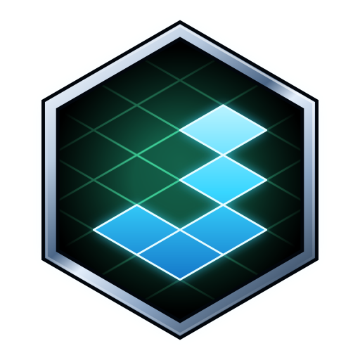

<p align="center">
  
</p>

<h1 align="center">SC4J</h1>

<p align="center">Java로 만든 실시간 전략 게임 엔진. 모드 런타임, 런처, P2P 온라인 플레이를 함께 제공합니다.</p>

<p align="center">
  <a href="https://central.sonatype.com/artifact/org.fogofwarlabs.sc4j/sc4j-engine"></a>
  <a href="LICENSE"></a>
</p>

<p align="center"><a href="README.md">English</a> | <b>한국어</b></p>

---

## SC4J 소개

SC4J(Simulation Core for Java)는 실시간 전략 게임을 위한 엔진입니다. SC4J용 게임은 **모드**이며, 모드 하나는 jar 파일 하나입니다. 런타임이 jar를 불러오고 런처가 목록에 보여 줍니다. 엔진은 모드에 결정적(deterministic) 시뮬레이션, 클라이언트 프레임워크, 리플레이와 저장 게임, LAN 플레이, 그리고 방, 채팅, 접속 상태를 위한 P2P 네트워크 Beacon.Link를 제공합니다. 중앙 서버는 없습니다. 모든 SC4J가 피어입니다.

이 저장소에는 엔진, 런처, 런타임, Beacon.Link와 세 가지 모드가 들어 있습니다.

| 모드 | 폴더 | 모드 id | 설명 |
|---|---|---|---|
| 데모 1 | [`mods/demo/`](mods/demo/) | `demo` | "SC4J Demo: Dawnhold and Cindermaw". 엔진만으로 만든 작은 실시간 전략 게임 |
| SC:R 모드 | [`mods/scr/`](mods/scr/) | `scr` | 스타크래프트: 리마스터 1.23.10을 SC4J 모드로 다시 구현한 것. 게임 데이터는 실행할 때 플레이어 본인의 스타크래프트: 리마스터 설치본에서 읽으며, 저장소와 jar에는 들어 있지 않습니다. |
| 데모 2 | [`mods/scr-demo/`](mods/scr-demo/) | `scr-demo` | "SC:R Clone Demo". 자체 정체성을 가진 SC:R 모드의 복제본으로, 자체 LAN 참가 버전과 추가 유닛 두 종이 있습니다. |

새 엔진 모드를 만드는 방법은 [모드 제작 가이드](docs/mod-guide.ko.md)에 있습니다.

## 기능

- **시뮬레이션**: 결정적 락스텝 방식이며 게임 루프마다 상태 해시를 계산합니다. 경로 탐색, 이동, 충돌, 시야, 경제, 채집, 전투, 투사체, 생산, 명령, 트리거, 컴퓨터 플레이어의 기본 시스템이 있고, 모드는 어느 시스템이든 자기 것으로 바꿀 수 있습니다.
- **콘텐츠**: 표준 데이터 팩(JSON 정의, PNG 그림, WAV 소리)과 파일 하나짜리 JSON 맵.
- **클라이언트**: 씬, 입력, OpenGL 렌더러, 정사각형과 아이소메트릭 투영, HUD를 갖춘 기본 게임 화면, 오디오와 동영상.
- **리플레이와 저장 게임**: 기록한 실행과 같은 모드 정체성에서만 불러옵니다.
- **네트워크 플레이**: LAN 방과 락스텝 게임, 인터넷에서는 Beacon.Link의 방, 채팅 채널, 귓속말, 친구, 접속 상태.
- **런처**: 설치본의 모드 목록을 보여 주고, 모드 설정을 받고, 런타임을 시작하며, 이 컴퓨터의 Beacon.Link 노드를 실행합니다.
- **모드 런타임**: 세션마다 모드 하나를 자체 클래스 로더에서 실행합니다. 모드 정체성은 엔진 버전, 모드, jar 내용으로 정해집니다.
- **API 목록**: 엔진 API를 모듈별로 기록하고 빌드에서 검사합니다([API 정책](docs/api-policy.ko.md)).

## 저장소 구성

| 경로 | 내용 |
|---|---|
| `sc4j-base` | 예외, 로깅, 바이너리, 파일, JSON, 텍스트 도우미 |
| `sc4j-mod-manifest` | 모드 매니페스트 `sc4j-mod.json`, 설정과 버전, 설치 폴더 구조 |
| `sc4j-engine-core` | 기본 모델: 고정소수점 연산, 맵 격자, 지형, 플레이어, 상태 해시, 콘텐츠 타입, 모드 정체성 |
| `sc4j-engine-sim` | 시뮬레이션: 게임, 유닛, 기본 시스템, 명령, 커맨드, 데이터 팩, 맵, 리플레이, 저장 |
| `sc4j-engine-net` | 네트워크 계층: 락스텝 전송, LAN 탐색, 네트워크 로비, Beacon.Link 인터페이스 |
| `sc4j-engine-client` | 클라이언트 프레임워크: 호스트, 씬, 입력, 렌더러, 투영, HUD, 콘솔, 오디오, 동영상 |
| `sc4j-engine` | 모드가 컴파일할 때 쓰는 모드 API와 클라이언트 애플리케이션 |
| `sc4j-runtime` | 모드 jar 하나를 창 모드 또는 헤드리스로 실행 |
| `sc4j-launcher` | 런처(JavaFX) |
| `sc4j-beaconlink-protocol`, `sc4j-beaconlink-peer`, `sc4j-beaconlink-node`, `sc4j-beaconlink` | Beacon.Link: 와이어 프로토콜, 피어 라이브러리, 헤드리스 노드, 런타임이 모드에 주는 클라이언트 |
| [`mods/`](mods/) | 세 모드: `demo`, `scr`(모듈 `scr-data`, `scr-game`, `scr-render`, `scr-net`, `scr-client`, `scr-benchmark`, SC:R 모드 비교용으로 원본 게임의 프레임을 읽기만 하는 기록기), `scr-demo` |
| [`tools/`](tools/) | `api-check`(API 목록) |
| [`docs/`](docs/) | 가이드와 참조 문서([목록](docs/README.ko.md)). `docs/branding/`: 로고, 배너, 모드의 런처 그림 |
| [`licenses/`](licenses/) | 서드파티 라이브러리의 라이선스 전문 |

## 빌드와 실행

JDK 25가 필요합니다. Gradle은 Gradle 래퍼가 내려받습니다. 아래 명령은 저장소 루트의 PowerShell에서 실행합니다. Linux에서는 `./gradlew`를 씁니다. SC:R 모드와 데모 2를 플레이하려면 스타크래프트: 리마스터 1.23.10 설치본이 필요하지만, 빌드에는 필요하지 않습니다.

| 명령 | 하는 일 |
|---|---|
| `.\gradlew.bat build` | 전체를 컴파일하고 단위 테스트와 검사를 실행 |
| `.\gradlew.bat :mods:demo:devInstall` | 개발용 설치본 `build/dev-install/` 구성(런처, 런타임, `mods/demo.jar`) |
| `.\gradlew.bat :mods:scr:devInstall` | 개발용 설치본에 `mods/scr.jar` 추가 |
| `.\gradlew.bat :mods:scr-demo:devInstall` | 개발용 설치본에 `mods/scr.jar`와 `mods/scr-demo.jar` 추가 |
| `.\gradlew.bat runDevLauncher` | 개발용 설치본의 런처 열기 |
| `.\gradlew.bat runDevInstall -Psc4j.mod=scr` | 개발용 설치본의 런타임을 `mods/scr.jar`로 실행(기본값 `demo`) |
| `.\gradlew.bat distribution` | 사용자 패키지 `build/distributions/SC4J-<version>.zip` 생성 |
| `.\gradlew.bat :sc4j-beaconlink-node:installDist` | 헤드리스 Beacon.Link 노드를 `sc4j-beaconlink-node/build/install/`에 빌드 |

처음 실행할 때:

```powershell
.\gradlew.bat :mods:demo:devInstall
.\gradlew.bat runDevLauncher
```

런처는 `build/dev-install/mods/`의 모든 jar를 보여 줍니다. 모드를 골라 시작하면 됩니다. SC:R 모드와 데모 2는 Windows에 기록된 위치에서 스타크래프트: 리마스터 폴더를 찾고, 찾지 못하면 모드 설정에서 한 번 지정하면 됩니다.

사용자 패키지에는 런처, 런타임, 데모 모드, Java 런타임, 시작 파일 `SC4J.bat`와 `SC4J`가 들어 있습니다. 사용자 데이터는 들어 있지 않으며, 새 설치본은 처음 시작할 때 `userdata/`를 만듭니다.

테스트 단계, 게임 폴더를 지정하는 Gradle 속성, 코드 스타일은 [CONTRIBUTING.ko.md](CONTRIBUTING.ko.md)에 있습니다.

## 문서

가이드는 [`docs/`](docs/README.ko.md)에 있으며, 모두 영어와 한국어로 제공합니다.

| 가이드 | 주제 |
|---|---|
| [모드 제작 가이드](docs/mod-guide.ko.md) | 첫 모드부터 네트워크 플레이까지, 엔진용 모드 만들기 |
| [SC:R 복제 모드 가이드](docs/mods/scr-demo.ko.md) | SC:R 모드를 복제해 자신의 모드 만들기(데모 2) |
| [엔진 API 정책](docs/api-policy.ko.md) | 엔진 API의 범위, 버전, 내부 요소 |
| [Beacon.Link 프로토콜](docs/beaconlink/protocol.ko.md) | Beacon.Link의 와이어 프로토콜과 파일 |
| [Beacon.Link 운영 가이드](docs/beaconlink/operator.ko.md) | 다른 플레이어를 위한 피어 운영: 헤드리스 노드와 런처 공개 모드 |
| [SCRECBIN 형식](mods/scr/docs/sc-recorder-format.ko.md) | 프레임 기록기의 파일 형식 |
| [브랜딩](docs/branding/README.ko.md) | 로고, 배너, 모드 그림과 PNG 내보내기 |
| [기여 안내](CONTRIBUTING.ko.md) | 개발 환경, 테스트, 코드 스타일, 커밋과 풀 리퀘스트 |

## 라이선스

SC4J는 [Apache License 2.0](LICENSE)으로 배포됩니다. 저장소와 배포본에 들어 있는 서드파티 자료는 [NOTICE](NOTICE)에 있고, 라이선스 전문은 [`licenses/`](licenses/)에 있습니다.

| 자료 | 라이선스 | 자세히 |
|---|---|---|
| 데모 1 그림: KayKit 모델과 Poly Haven 텍스처의 렌더 | CC0 1.0 | [`mods/demo/THIRD-PARTY.md`](mods/demo/THIRD-PARTY.md) |
| 데모 2 유닛 그림: Unity-chan | Unity-chan License 3.0 | [`mods/scr-demo/third-party/unity-chan/`](mods/scr-demo/third-party/unity-chan/) |
| 데모 2 유닛 그림: Unity-chan이 든 소총(Quaternius) | CC0 1.0 | [`mods/scr-demo/third-party/unity-chan/`](mods/scr-demo/third-party/unity-chan/) |
| 데모 2 유닛 그림: Myriarch(OSCAR CREATIVO의 DRAGO 3D 모델) | CC BY 4.0 | [`mods/scr-demo/third-party/myriarch/`](mods/scr-demo/third-party/myriarch/) |
| 배포본의 라이브러리(LWJGL, JavaCPP, FFmpeg, OpenJFX 등) | 각 라이브러리의 라이선스 | [NOTICE](NOTICE), [`licenses/`](licenses/) |

StarCraft는 Blizzard Entertainment, Inc.의 상표입니다. SC4J는 Blizzard Entertainment와 제휴하거나 승인받지 않았습니다. SC:R 모드는 플레이어 본인의 스타크래프트: 리마스터 설치본에서 게임 데이터를 읽으며, 저장소와 배포본에는 그런 데이터가 들어 있지 않습니다.
