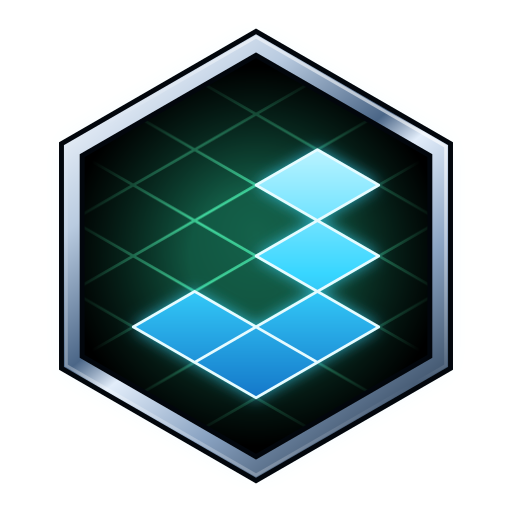

<p align="center">
  
</p>

<h1 align="center">SC4J</h1>

<p align="center">A real-time strategy engine in Java, with a mod runtime, a launcher and peer-to-peer online play.</p>

<p align="center">
  <a href="https://central.sonatype.com/artifact/org.fogofwarlabs.sc4j/sc4j-engine"></a>
  <a href="LICENSE"></a>
</p>

<p align="center"><b>English</b> | <a href="README.ko.md">한국어</a></p>

---

## What SC4J is

SC4J (Simulation Core for Java) is an engine for real-time strategy games. A game for it is a **mod**: one jar that the runtime loads and the launcher lists. The engine gives a mod a deterministic simulation, a client framework, replays and saved games, LAN play and Beacon.Link, the peer-to-peer network for rooms, chat and presence. Nobody runs a central server: every SC4J is a peer.

This repository holds the engine, the launcher, the runtime, Beacon.Link and three mods:

| Mod | Folder | Mod id | What it is |
|---|---|---|---|
| Demo 1 | [`mods/demo/`](mods/demo/) | `demo` | "SC4J Demo: Dawnhold and Cindermaw", a small real-time strategy game made only of the engine |
| SC:R mod | [`mods/scr/`](mods/scr/) | `scr` | StarCraft: Remastered 1.23.10 reimplemented as an SC4J mod. It reads the game data of the player's own StarCraft: Remastered installation at run time; the repository and the jar hold none of it. |
| Demo 2 | [`mods/scr-demo/`](mods/scr-demo/) | `scr-demo` | "SC:R Clone Demo", a clone of the SC:R mod under its own identity, with its own LAN join version and two added units |

The [mod author guide](docs/mod-guide.md) shows how to make a new mod for the engine.

## Features

- **Simulation**: lockstep and deterministic, with a state hash per game loop. Default systems for path finding, movement, collision, visibility, economy, harvest, combat, projectiles, production, orders, triggers and computer players; a mod can replace any of them.
- **Content**: the standard data pack (JSON definitions, PNG pictures, WAV sounds) and one-file JSON maps.
- **Client**: scenes, input, an OpenGL renderer, square and isometric projections, a default in-game screen with HUD, audio and video.
- **Replays and saved games**: they load only with the same mod identity as the run that wrote them.
- **Network play**: LAN rooms and lockstep games; Beacon.Link rooms, chat channels, whispers, friends and presence over the Internet.
- **Launcher**: lists the mods of an install, asks for their settings, starts the runtime and runs the computer's Beacon.Link node.
- **Mod runtime**: one mod per session in its own class loader; a mod identity from the engine version, the mod and the jar's content.
- **API listings**: the engine API is listed per module and checked by the build ([API policy](docs/api-policy.md)).

## Repository layout

| Path | Contents |
|---|---|
| `sc4j-base` | exceptions, logging, binary, file, JSON and text helpers |
| `sc4j-mod-manifest` | the mod manifest `sc4j-mod.json`, its settings and versions, the install folder layout |
| `sc4j-engine-core` | leaf models: fixed-point math, map grid, terrain, players, state hash, content types, mod identity |
| `sc4j-engine-sim` | the simulation: game, units, default systems, orders, commands, data pack, maps, replays, saves |
| `sc4j-engine-net` | the network layer: lockstep transport, LAN discovery, network lobby, the Beacon.Link interfaces |
| `sc4j-engine-client` | the client framework: host, scenes, input, renderer, projections, HUD, console, audio, video |
| `sc4j-engine` | the mod API and the client application that mods compile against |
| `sc4j-runtime` | runs one mod jar, in a window or headless |
| `sc4j-launcher` | the launcher (JavaFX) |
| `sc4j-beaconlink-protocol`, `sc4j-beaconlink-peer`, `sc4j-beaconlink-node`, `sc4j-beaconlink` | Beacon.Link: the wire protocol, the peer library, the headless node and the client that the runtime gives a mod |
| [`mods/`](mods/) | the three mods: `demo`, `scr` (modules `scr-data`, `scr-game`, `scr-render`, `scr-net`, `scr-client`, `scr-benchmark` and a read-only frame recorder of the native game, used to compare the SC:R mod), `scr-demo` |
| [`tools/`](tools/) | `api-check` (API listings) |
| [`docs/`](docs/) | the guides and references ([index](docs/README.md)); `docs/branding/`: logos, banners and the launcher art of the mods |
| [`licenses/`](licenses/) | the licence texts of the third-party libraries |

## Build and run

You need JDK 25. The Gradle wrapper downloads Gradle itself. Commands run in PowerShell from the repository root; on Linux use `./gradlew`. The SC:R mod and demo 2 need a StarCraft: Remastered 1.23.10 installation to play; the build does not.

| Command | What it does |
|---|---|
| `.\gradlew.bat build` | compiles everything, runs the unit tests and the checks |
| `.\gradlew.bat :mods:demo:devInstall` | assembles the development install `build/dev-install/` (launcher, runtime, `mods/demo.jar`) |
| `.\gradlew.bat :mods:scr:devInstall` | adds `mods/scr.jar` to the development install |
| `.\gradlew.bat :mods:scr-demo:devInstall` | adds `mods/scr.jar` and `mods/scr-demo.jar` to the development install |
| `.\gradlew.bat runDevLauncher` | opens the launcher of the development install |
| `.\gradlew.bat runDevInstall -Psc4j.mod=scr` | runs the runtime of the development install with `mods/scr.jar` (default `demo`) |
| `.\gradlew.bat distribution` | builds the user package `build/distributions/SC4J-<version>.zip` |
| `.\gradlew.bat :sc4j-beaconlink-node:installDist` | builds the headless Beacon.Link node into `sc4j-beaconlink-node/build/install/` |

A first run:

```powershell
.\gradlew.bat :mods:demo:devInstall
.\gradlew.bat runDevLauncher
```

The launcher lists every jar in `build/dev-install/mods/`. Choose a mod and start it. For the SC:R mod and demo 2 the launcher looks for the StarCraft: Remastered folder where Windows records the game; if it is not found there, set it once in the mod's settings.

The user package holds the launcher, the runtime, the demo mod, a Java runtime and the start files `SC4J.bat` and `SC4J`. It holds no user data: a fresh install makes `userdata/` at its first start.

Test tiers, the Gradle property for the game folder and the code style are in [CONTRIBUTING.md](CONTRIBUTING.md).

## Documentation

The guides are in [`docs/`](docs/README.md), each in English and Korean.

| Guide | Topic |
|---|---|
| [Mod author guide](docs/mod-guide.md) | making a mod for the engine, from the first mod to network play |
| [SC:R clone modder guide](docs/mods/scr-demo.md) | cloning the SC:R mod into your own mod (demo 2) |
| [Engine API policy](docs/api-policy.md) | what the engine API is, its versions and the internal elements |
| [Beacon.Link protocol](docs/beaconlink/protocol.md) | the wire protocol and the files of Beacon.Link |
| [Beacon.Link operator guide](docs/beaconlink/operator.md) | running a peer for other players: the headless node and the launcher's public mode |
| [SCRECBIN format](mods/scr/docs/sc-recorder-format.md) | the file format of the frame recorder |
| [Branding](docs/branding/README.md) | the logos, banners and mod art, and how to export them |
| [Contributing](CONTRIBUTING.md) | setup, tests, code style, commits and pull requests |

## Licence

SC4J is licensed under the [Apache License 2.0](LICENSE). [NOTICE](NOTICE) lists the third-party material of the repository and its distributions; the licence texts are in [`licenses/`](licenses/).

| Material | Licence | Details |
|---|---|---|
| Demo 1 pictures: renders of KayKit models and Poly Haven textures | CC0 1.0 | [`mods/demo/THIRD-PARTY.md`](mods/demo/THIRD-PARTY.md) |
| Demo 2 unit art: Unity-chan | Unity-chan License 3.0 | [`mods/scr-demo/third-party/unity-chan/`](mods/scr-demo/third-party/unity-chan/) |
| Demo 2 unit art: the rifle Unity-chan holds (Quaternius) | CC0 1.0 | [`mods/scr-demo/third-party/unity-chan/`](mods/scr-demo/third-party/unity-chan/) |
| Demo 2 unit art: the Myriarch (DRAGO 3D model by OSCAR CREATIVO) | CC BY 4.0 | [`mods/scr-demo/third-party/myriarch/`](mods/scr-demo/third-party/myriarch/) |
| Libraries of the distributions (LWJGL, JavaCPP, FFmpeg, OpenJFX and others) | their own licences | [NOTICE](NOTICE), [`licenses/`](licenses/) |

StarCraft is a trademark of Blizzard Entertainment, Inc. SC4J is not affiliated with or endorsed by Blizzard Entertainment. The SC:R mod reads the game data of the player's own StarCraft: Remastered installation; the repository and its distributions carry no such data.
