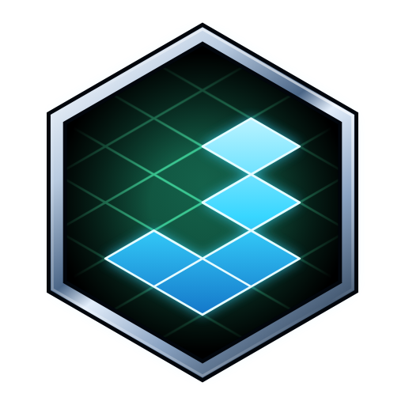
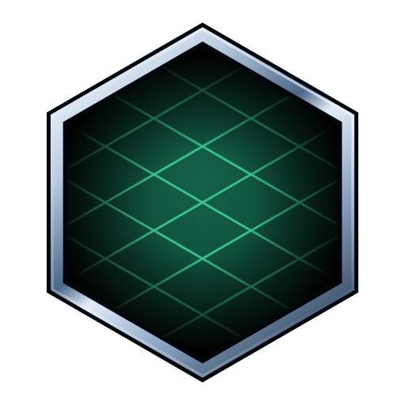

# 브랜딩

[English](README.md) | **한국어**

Fog of War Labs와 SC4J의 로고, 그리고 데모 모드의 런처 그림(아이콘과 배너)입니다.

<p align="center">
  
  &nbsp;&nbsp;
  
</p>

- [파일](#파일)
- [색](#색)
- [모드 그림](#모드-그림)
- [PNG 내보내기](#png-내보내기)

## 파일

| 파일 | 내용 |
|---|---|
| `fogofwarlabs-logo.svg` | Fog of War Labs 로고, 원본 |
| `fogofwarlabs-logo-512.png`, `fogofwarlabs-logo-1024.png` | Fog of War Labs 로고, 512와 1024픽셀 정사각형(조직 아바타) |
| `sc4j-logo.svg` | SC4J 로고, 원본 |
| `sc4j-logo-512.png`, `sc4j-logo-1024.png` | SC4J 로고, 512와 1024픽셀 정사각형(저장소 소셜 미리보기, README) |
| `sc4j-banner.svg` | SC4J 배너, 원본(950 x 150) |
| `sc4j-banner-950x150.png`, `sc4j-banner-1900x300.png` | SC4J 배너, 950 x 150과 1900 x 300픽셀(저장소와 소셜 배너) |
| `demo-mod/icon.svg`, `demo-mod/banner.svg` | 데모 모드(Dawnhold and Cindermaw)의 런처 아이콘과 배너 |

빌드에 있는 복사본:

| 복사본 | 원본 |
|---|---|
| `sc4j-launcher/src/main/resources/.../ui/theme/images/sc4j-logo-512.png`와 `fogofwarlabs-logo-512.png` | 여기 있는 512픽셀 PNG 파일과 같은 이미지 |
| `mods/demo/src/main/resources/meta/icon.png`와 `banner.png` | `demo-mod/icon.svg`와 `demo-mod/banner.svg` |

## 색

로고에 쓰는 색:

| 요소 | 색 |
|---|---|
| 스틸 | `#f6faff` .. `#26394f` |
| 지면 | `#14614a` / `#0a3a2b` |
| 격자 | `#3fd39a` |
| 강조 청록 | `#38d6ff` |
| J | `#b9f3ff` .. `#1477c9` |

## 모드 그림

런처는 모드 목록과 배너 카드에 모드의 아이콘을 보여 주고, 배너는 높이 128 단위의 카드를 덮도록 크기를 맞춥니다(양옆이나 위아래가 잘림). 배너 왼쪽 아래에는 런처가 모드 이름과 버전을 그리므로 그 부분은 어둡게 둡니다.

## PNG 내보내기

SVG는 마스크와 필터를 씁니다. ImageMagick의 내장 SVG 렌더러가 아니라 브라우저 엔진으로 렌더합니다.

| 이미지 | 크기(픽셀) |
|---|---|
| 로고 | 512 x 512와 1024 x 1024 |
| 모드 아이콘 | 512 x 512 |
| 모드 배너 | 1740 x 256 |
| SC4J 배너 | 950 x 150과 1900 x 300 |

1. 크기 `W x H`마다, SVG 옆에 그 크기로 보여 주는 페이지를 씁니다.

   ```html
   <!doctype html><html><body style="margin:0;background:transparent">.svg" width="W" height="H" style="display:block"></body></html>
   ```

2. Chromium 기반 브라우저(Chrome, Chromium, Edge)를 헤드리스 모드로 실행해 투명 스크린숏을 찍습니다.

   ```text
   <browser> --headless=new --disable-gpu --hide-scrollbars --allow-file-access-from-files --default-background-color=00000000 --window-size=W,H --screenshot=<out>.png <page>.html
   ```
