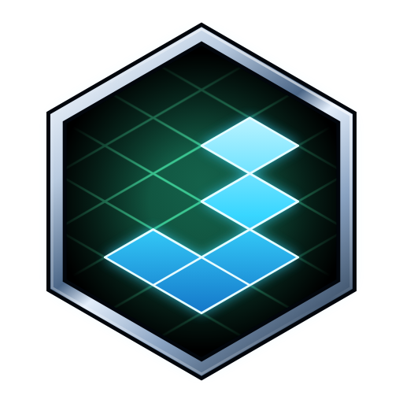
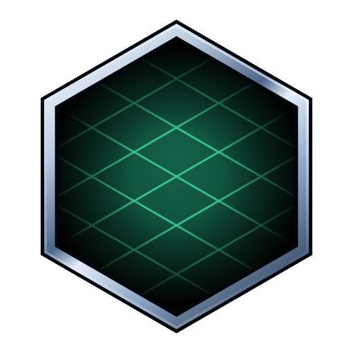

# Branding

**English** | [한국어](README.ko.md)

The logos of Fog of War Labs and SC4J, and the launcher art (icon and banner) of the demo mod.

<p align="center">
  
  &nbsp;&nbsp;
  
</p>

## Files

| File | What it is |
|---|---|
| `fogofwarlabs-logo.svg` | Fog of War Labs logo, source |
| `fogofwarlabs-logo-512.png`, `fogofwarlabs-logo-1024.png` | Fog of War Labs logo, 512 and 1024 pixels square (organization avatar) |
| `sc4j-logo.svg` | SC4J logo, source |
| `sc4j-logo-512.png`, `sc4j-logo-1024.png` | SC4J logo, 512 and 1024 pixels square (repository social preview, README) |
| `sc4j-banner.svg` | SC4J banner, source (950 x 150) |
| `sc4j-banner-950x150.png`, `sc4j-banner-1900x300.png` | SC4J banner, 950 x 150 and 1900 x 300 pixels (repository and social banner) |
| `demo-mod/icon.svg`, `demo-mod/banner.svg` | launcher icon and banner of the demo mod (Dawnhold and Cindermaw) |

Copies in the build:

| Copy | Exported from |
|---|---|
| `sc4j-launcher/src/main/resources/.../ui/theme/images/sc4j-logo-512.png` and `fogofwarlabs-logo-512.png` | the same images as the 512 pixel PNG files here |
| `mods/demo/src/main/resources/meta/icon.png` and `banner.png` | `demo-mod/icon.svg` and `demo-mod/banner.svg` |

## Colours

| Element | Colours |
|---|---|
| steel | `#f6faff` .. `#26394f` |
| ground | `#14614a` / `#0a3a2b` |
| grid | `#3fd39a` |
| accent cyan | `#38d6ff` |
| J | `#b9f3ff` .. `#1477c9` |

## Mod art

The launcher shows a mod's icon in the mod list and on the banner card, and scales the banner to cover a card 128 units high (cropped at the sides or at the top and bottom). The launcher draws the mod name and version over the lower left of the banner, so that part should stay dark.

## Exporting PNG

The SVGs use masks and filters: render them with a browser engine, not ImageMagick's built-in SVG renderer.

| Image | Size (pixels) |
|---|---|
| logo | 512 x 512 and 1024 x 1024 |
| mod icon | 512 x 512 |
| mod banner | 1740 x 256 |
| SC4J banner | 950 x 150 and 1900 x 300 |

1. For a size `W x H`, write a page next to the SVG that shows it at that size:

   ```html
   <!doctype html><html><body style="margin:0;background:transparent">.svg" width="W" height="H" style="display:block"></body></html>
   ```

2. Take a transparent screenshot of it with a Chromium-based browser (Chrome, Chromium or Edge) in headless mode:

   ```text
   <browser> --headless=new --disable-gpu --hide-scrollbars --allow-file-access-from-files --default-background-color=00000000 --window-size=W,H --screenshot=<out>.png <page>.html
   ```
